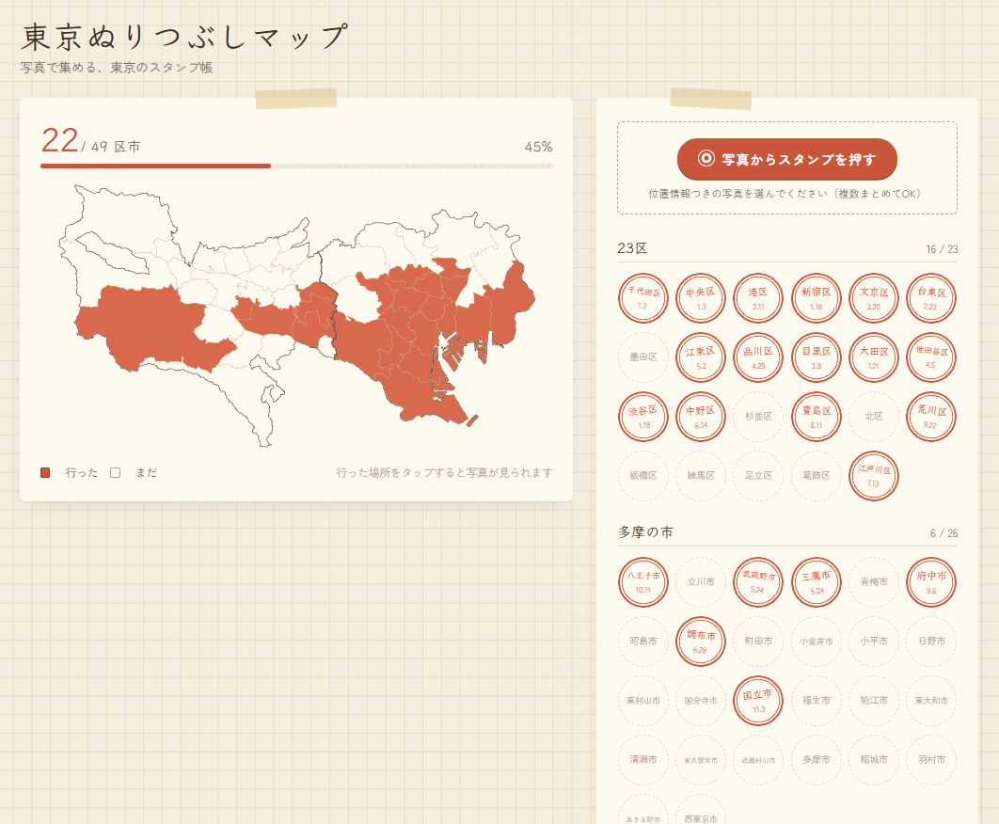
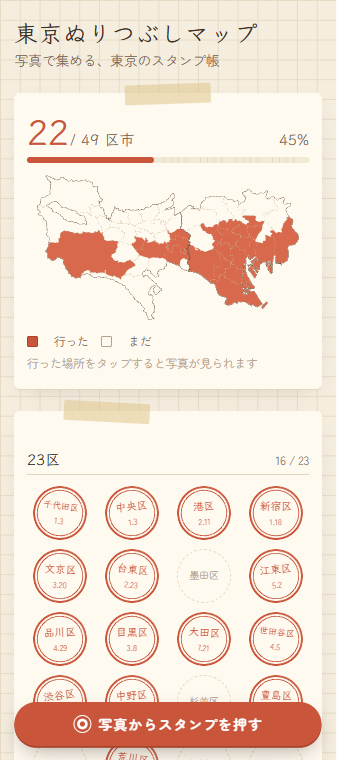

# 東京ぬりつぶしマップ

**写真で集める、東京のスタンプ帳。**

位置情報つきの写真を選ぶだけで、撮った場所の区や市にスタンプが押され、東京の地図が少しずつ塗られていく Web アプリです。

**▶ https://bswitchqrb.github.io/tokyo-photo-map/**

<p>
  
  
</p>

<sub>※ 画面はサンプルデータで表示しています。</sub>

## できること

- **写真からスタンプを押す** — 写真の位置情報（EXIF）から撮影場所の区市を判定して、スタンプ帳と地図に記録します。複数枚まとめて選べます
- **スタンプ帳** — 23区と多摩の26市、49か所の枠が並び、行った場所には撮影日入りのスタンプが押されます
- **思い出の写真** — 区市ごとに写真を1枚残し、スタンプや地図をタップするといつでも見返せます
- **スマホで使いやすく** — 地図はタップで区市名を表示し、写真ボタンは画面下に固定しています
- **記録の書き出し・読み込み** — CSV で保存して、別の端末に移せます

## プライバシー

写真はブラウザの中だけで読み取り、**サーバーには一切送信しません**。外部の地図 API も使っていません。
思い出として残すのは、縮小して位置情報などのメタデータを取り除いた画像だけで、端末のブラウザ（IndexedDB）に保存されます。

## 工夫したところ

### 境界データを 10MB から 120KB に
国土数値情報の境界データ（約10MB）をそのまま同梱すると、スマホでの初回表示が重くなります。[mapshaper](https://github.com/mbloch/mapshaper) で頂点を減らして約120KB にしました（`npm run geo:build`）。

元データは「1つのポリゴンの中に外周が複数入っている」「面積ゼロの潰れたリングが混ざっている」という形で、そのまま簡略化すると江東区や江戸川区の埋立地が消えてしまいました。そこで、先にポリゴンを正規化してから簡略化し、d3-geo に合わせてリングの向きも直しています。
ランダムな3000地点で元データと判定結果を比べ、不一致は境界ぎりぎりの 0.2% だけであることを確認しました。

### ブラウザだけで区市を判定
写真の座標がどの区市に入るかは、[d3-geo](https://github.com/d3/d3-geo) の `geoContains` でブラウザの中で判定しています。サーバーが不要なので、GitHub Pages だけで動きます。

### テストと CI
区市の判定（埋立地や都外の地点も含む）、CSV の読み書き、記録のマージを Vitest でテストしています。GitHub Actions では、型チェックとテストが通ったときだけデプロイします。

## 技術スタック

| 分類 | 使用技術 |
|---|---|
| フロントエンド | React 19 / TypeScript / Rsbuild |
| 地図・位置情報 | d3-geo / exifr（EXIF の読み取り） |
| 保存 | localStorage（記録）/ IndexedDB（写真） |
| データ加工 | mapshaper（境界データの簡略化） |
| テスト・CI | Vitest / GitHub Actions / GitHub Pages |

## 開発

```bash
npm install
npm run dev        # 開発サーバー（http://localhost:3000）
npm test           # テスト
npm run typecheck  # 型チェック
npm run build      # dist/ に出力
npm run geo:build  # 境界データを元データから作り直す
```

## データの出典

市区の境界データは、「[国土数値情報（行政区域データ）](https://nlftp.mlit.go.jp/ksj/gml/datalist/KsjTmplt-N03-2024.html)」（国土交通省）をもとに bswitchQrb が作成しました。2020年1月1日時点のデータから東京都の23区と26市を取り出し、座標の丸めと形状の簡略化をしています。

- 元データ: `data-src/tokyo.raw.geojson.json`
- アプリで使う簡略化版: `src/data/tokyo.geojson.json`

これらのデータは国土数値情報の[利用規約](https://nlftp.mlit.go.jp/ksj/other/agreement.html)に従います（MIT ライセンスの対象外です）。

## フォント

[Klee One](https://fonts.google.com/specimen/Klee+One)・[Zen Maru Gothic](https://fonts.google.com/specimen/Zen+Maru+Gothic)（SIL Open Font License 1.1）を Google Fonts から読み込んでいます。

## ライセンス

ソースコードは [MIT License](LICENSE) です。© 2026 bswitchQrb
